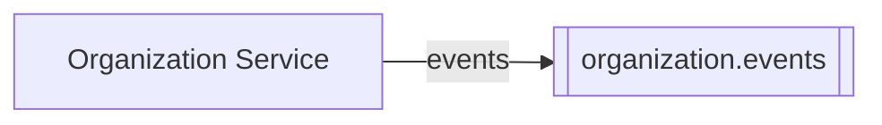
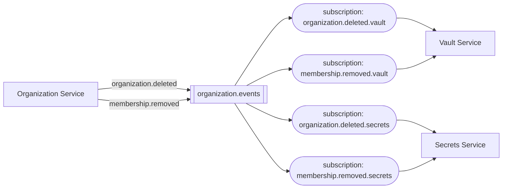

# Publishing events

## Event topics

Every service that publishes one or more events has exactly one event topic, `{service}.events`, to
which all of its events are published. Other services `MUST NOT` be able to send to it.

## Subscribing

A service subscribes to each event type it consumes with a subscription of its own: **one
subscription per event type per consuming service**. The broker does the filtering, so a service
never receives an event type it has not subscribed to, and a burst of one type never holds up
another.

- The Vault Service and the Secrets Service each consume two event types, so each has two
  subscriptions of its own.
- Only the service that owns a subscription may read from it.
- Subscription names in the diagram are illustrative.

## Naming

Event names `MUST` be lowercase words separated by dots, and `SHOULD` be in the past tense, for what
happened, such as `user.deleted`.

## Breaking changes

A publisher `MUST NOT` make a breaking change to a version of an event it already publishes, except
to fix a [bug](./index.md#versioning). A change that would break subscribers goes into a new version
of the event instead, as [Versioning](./index.md#versioning) describes.

The publisher owns an event's contract and writes the event, so a change to an existing version is
breaking when the publisher stops sending something that subscribers that have not yet deployed rely
on.

These changes need a new version:

- Changing a field's type, format, meaning, or units.
- Renaming a required field.
- Removing a required field.
- Making a required field optional.

These changes can be made within a version:

- Adding a field, required or optional.
- Making an optional field required.
- Adding a constraint to a field.
- Removing an optional field.
