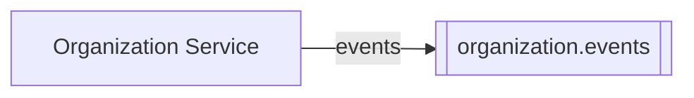
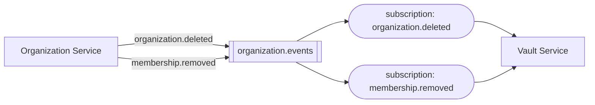

# Publishing events

## Event topics

Every service that publishes one or more events has exactly one event topic, `<service>.events`, to
which all of its events are published. Only that service may send to it.

## Subscribing

A service subscribes to each event type it consumes with a subscription of its own: **one
subscription per event type**. The broker does the filtering, so a service never receives an event
type it has not subscribed to, and a burst of one type never holds up another.

- The Vault Service consumes two event types, so it has two subscriptions.
- Only the Vault Service may read from them.

## Naming

Events are named in the past tense, for what happened, such as `user.deleted`.

## Breaking changes

The publisher owns an event's contract and writes the event, so a change is breaking when the
publisher stops sending something that subscribers that have not yet deployed rely on.

These changes are breaking:

- Changing a field's type, format, meaning, or units.
- Renaming a required field.
- Removing a required field.
- Making a required field optional.

These changes are not:

- Adding a field, required or optional.
- Making an optional field required.
- Adding a constraint to a field.
- Removing an optional field.

[Versioning](./index.md#versioning) covers what to do when a breaking change is unavoidable.
