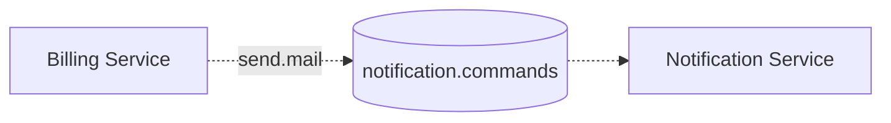

# Sending commands

## Command queues

A service that accepts commands has exactly one command queue, `{service}.commands`. Other services
send commands to it, and only the owner reads from it. The owner decides which services may send
which commands.

The queue is first in, first out, but retries and competing instances mean commands can be processed
in any order.

## Naming

Commands `SHOULD` be named in the imperative, for what to do, such as `send.mail`.

## Breaking changes

A receiver `MUST NOT` make a breaking change to a command type it already accepts.

The receiver owns a command's contract and reads the command, so a change is breaking when the
receiver demands something that senders that have not yet deployed do not send.

These changes are breaking:

- Changing a field's type, format, meaning, or units.
- Renaming a required field.
- Adding a required field.
- Making an optional field required.
- Adding a constraint to a field.

These changes are not:

- Removing a field, required or optional.
- Making a required field optional.
- Adding an optional field.

When a breaking change is unavoidable, the receiver introduces a new version of the command type, as
[Versioning](./index.md#versioning) describes.
