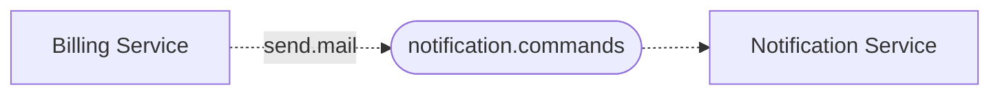

# Sending commands

## Command queues

A service that accepts commands has exactly one command queue, `{service}.commands`. Other services
send commands to it. Services other than the owner `MUST NOT` be able to read from it.

The queue is first in, first out, but retries and competing instances mean commands can be processed
in any order.

## Naming

Commands `SHOULD` be named in the imperative, for what to do, such as `send.mail`.

## Breaking changes

A receiver `MUST NOT` make a breaking change to a version of a command it already accepts, except to
fix a [bug](./index.md#versioning). A change that would break senders goes into a new version of the
command instead, as [Versioning](./index.md#versioning) describes.

The receiver owns a command's contract and reads the command, so a change to an existing version is
breaking when the receiver demands something that senders that have not yet deployed do not send.

These changes need a new version:

- Changing a field's type, format, meaning, or units.
- Renaming a required field.
- Adding a required field.
- Making an optional field required.
- Adding a constraint to a field.

These changes can be made within a version:

- Removing a field, required or optional.
- Making a required field optional.
- Adding an optional field.
