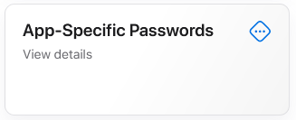
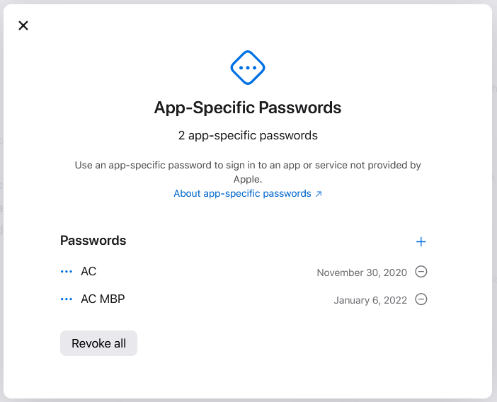

---
sidebar_custom_props:
  access: bitwarden
---

# Mac App Store Dev

:::warning

The Mac App Store (MAS) Dev build is only required to test certain features that are exclusive to
the MAS. In general, you should use the main build instructions (using `npm run electron`) unless
you have a specific reason for needing the MAS build.

:::

## Setup

These steps can be quite tricky. If you encounter any difficulties, post in the `#team-eng` Slack
channel for assistance.

### Xcode

1. Install [Xcode from the App Store](https://apps.apple.com/us/app/xcode/id497799835?mt=12).

1. Login with your AppleID that is a member of the 8bit solutions LLC organization. This can be done
   from `Xcode > Preferences ... > Accounts`

1. Ensure you have a personal code signing certificate assigned to Bitwarden Inc by clicking the
   `Bitwarden Inc` team and clicking `Manage Certificates...`.

1. If no certificate is listed, click the plus sign (`+`) to create one.

### Keychain

Verify that your Apple Keychain contains a value for `AC_PASSWORD`, if not we’ll need to generate
one.

1. Login using your Apple Account on the [Apple-ID website](https://appleid.apple.com/).

2. Click on “App-Specific Passwords”

   

3. And then click on the `+` icon next to `Passwords` to add a new App-Specific Password.
   

4. Save the new App-specific password using

```bash
security add-generic-password -a "<apple_id>" -w "<app_specific_password>" -s "AC_PASSWORD"
```

### Provisioning Profile

1. Retrieve your Mac "Provisioning UDID" by going to "System Information > Hardware" and copying the
   `Provisioning UDID:` row.
2. Ask BRE (@bre in slack) to have your `Apple Development` signing certificate and device UDID
   added to the following provisioning profiles:
   - PM Beta Desktop-App Testing
   - PM Beta Desktop-ExtAutofill Testing
   - PM Dev Desktop-App Testing
   - PM Stable Desktop-App Testing
   - PM Stable Desktop-ExtAutofill Testing

3. Once everything is added, download the provisioning profiles from
   https://developer.apple.com/account/resources/profiles/list.

4. Install each provisioning profile to your device by double-clicking it, which will open a System
   Settings window. This will allow your machine to trust and execute the apps built with this
   profile.

5. Copy the provisioning profiles to the locations required for building. They must go in both
   `clients/apps/desktop` and the Xcode provisioning profile directory. Here is an example script
   demonstrating this:
   ```bash
    mkdir -p ~/Library/Developer/Xcode/UserData/Provisioning\ Profiles
    cp ~/Downloads/PM_*.provisionprofile clients/apps/desktop
    for profile in ~/Downloads/PM_*.provisionprofile; do
      uuid=$(/usr/libexec/PlistBuddy -c "Print :UUID" <(security cms -D -i "$profile"))
      if [ -z "$uuid" ]; then
        echo "Could not read UUID from $profile, skipping" >&2
        continue
      fi
      cp -v "$profile" ~/Library/Developer/Xcode/UserData/Provisioning\ Profiles/"$uuid".provisionprofile
    done
   ```

### Building

1. Identify the name of your personal development certificate by running:
   ```zsh
   security find-identity -v | grep 'Apple Development'
   ```
2. Ensure the CSC_NAME environment variable is set by running export CSC_NAME="", the value should
   be the output from find-identity without the Apple Development: portion.

3. Run `npm run dist:mac:masdev`.

   :::info

   If this is your first time running desktop locally, be sure to run `npm ci` before
   `npm run dist:mac:masdev`.

   :::

### Troubleshooting

If you receive an error stating `You do not have permission to open the application "Bitwarden".`
ensure the correct provisioning profile is placed in the desktop repository root.

## Testing in QA

Per the SDLC, QA verifies changes before they are merged into main. Currently the GitHub CI
workflows for building the Mac desktop client do not create a build artifact for the Mac App Store
as part of the workflow run. QA can obtain a build through these steps:

1. Navigate to the `Build Desktop` workflow under the `GitHub Actions` tab.
2. Click the `Run workflow` dropbox.
   - Select the branch in question.
   - Ensure "Force distribute to TestFlight" is checked.
