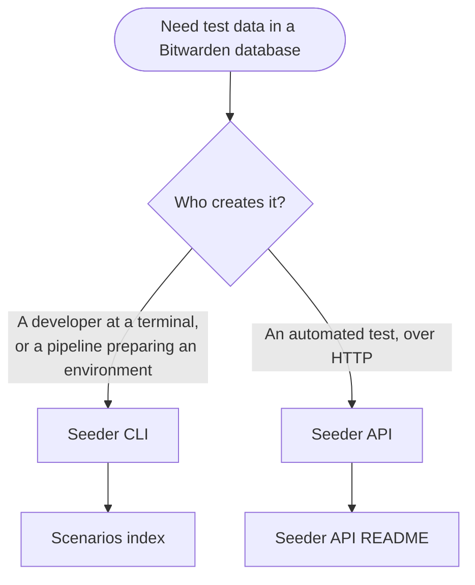

# Seeder

The Seeder is a library that fills a Bitwarden database with production-shaped test data so
developers spend time building instead of hand-entering test data. It has two entry points: the
Seeder command line interface (CLI) and the Seeder web API. Both write directly to the database;
therefore additional services do not need to be running while you seed.

**Audience:** Every developer who needs test data in a Bitwarden database, including community
contributors.

:::warning Not for production

The Seeder CLI and Seeder API write directly to the database your user secrets point to. Never run
them against a production database. All information created by the Seeder is test data.

:::

## Choose an entry point

> _Perspective: Any developer who needs test data in a Bitwarden database, choosing a Seeder entry
> point and the document to open next. Container level. Omits the Seeder class library both entry
> points share._

### Seeder CLI

The Seeder CLI lives in `util/SeederUtility` in the server repository and seeds on demand. Use it
when you want data that stays in the database, such as the accounts you log in with every day. It
has three commands:

- `preset` loads a curated JSON fixture from the catalog, which creates the same users,
  organizations, and items every time.
- `organization` builds one organization from flags you pass, such as a name or plan type, when no
  preset fits.
- `individual` builds one user from flags you pass, such as a name or subscription, when no preset
  fits.

If you do not know what to seed yet, start with the
[scenarios index](https://github.com/bitwarden/server/blob/main/util/Seeder/Seeds/docs/scenarios/README.md),
which maps common problems to commands. If you do, browse the
[presets catalog](https://github.com/bitwarden/server/blob/main/util/Seeder/Seeds/docs/presets.md)
or the flags in the
[Seeder CLI README](https://github.com/bitwarden/server/blob/main/util/SeederUtility/README.md).

### Seeder API

The Seeder API is the HTTP entry point for automated test suites. A test run is a play, and each
request to Seeder API performs a scene that creates the data the test needs. The run tags everything
it creates with its play ID, so Seeder API can clean it all up afterward. It is not the tool for
data you want to keep. The
[Seeder API README](https://github.com/bitwarden/server/blob/main/util/SeederApi/README.md)
describes how tests use it and how to configure it.

## Seed the database

Run the Seeder CLI whenever a database needs data: right after setup, after a reset, or when you
need a scenario it does not hold yet. The database your user secrets configure must be running and
migrated, on any provider the server supports. Presets that create attachments also need
[Azurite](./guide.md#azurite) or a local attachment directory. You need the Api and Identity
services only when you log in afterward.

1.  Finish the [Setup Guide](./guide.md) through [Start the server](./guide.md#start-the-server), or
    [Manual Setup](./manual-setup.md) through [Create database](./manual-setup.md#create-database),
    or the [Entity Framework](./database/ef/index.mdx) page for your provider. Each path creates and
    migrates the database, and the [Configure user secrets](./guide.md#configure-user-secrets) step
    applies `dev/secrets.json` to the Seeder CLI as well.
2.  In the server repository, ask your AI coding agent for the data you need in plain words, such as
    "an organization to test collection permissions". The
    [seeding-bitwarden-data skill](https://github.com/bitwarden/server/blob/main/.claude/skills/seeding-bitwarden-data/SKILL.md)
    picks a preset, runs the Seeder CLI, and lists the logins it created. Without an agent, find
    your problem in the
    [scenarios index](https://github.com/bitwarden/server/blob/main/util/Seeder/Seeds/docs/scenarios/README.md)
    and run its command from the `util/SeederUtility` folder. Start from a preset, and use
    `organization` or `individual` only when no preset fits. The first run also builds the Rust SDK
    shim with cargo, so it takes longer.
3.  Start the server if it is not running, point a client at it as described in
    [Client connection](./guide.md#client-connection), and log in with an account the run created.
    The
    [Seeder CLI README](https://github.com/bitwarden/server/blob/main/util/SeederUtility/README.md)
    documents the default password and how emails are derived.

## Where to go next

- [Seeder CLI README](https://github.com/bitwarden/server/blob/main/util/SeederUtility/README.md):
  every command, its flags, and worked examples.
- [Seeder API README](https://github.com/bitwarden/server/blob/main/util/SeederApi/README.md): how
  automated tests use it and how to configure it.
- [Presets catalog](https://github.com/bitwarden/server/blob/main/util/Seeder/Seeds/docs/presets.md):
  every preset, organized by purpose.
- [Scenarios index](https://github.com/bitwarden/server/blob/main/util/Seeder/Seeds/docs/scenarios/README.md):
  problem to command guides, such as a fresh database or permission testing.
